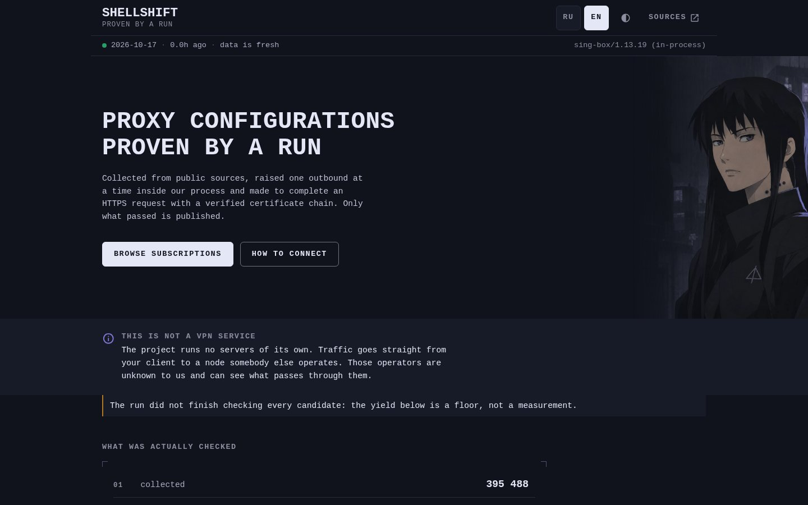
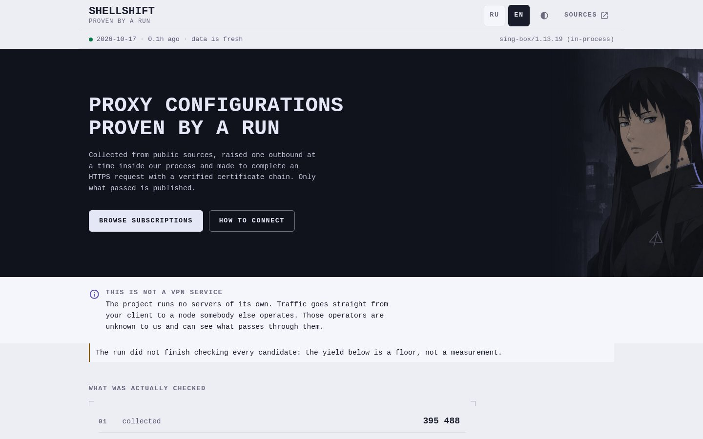
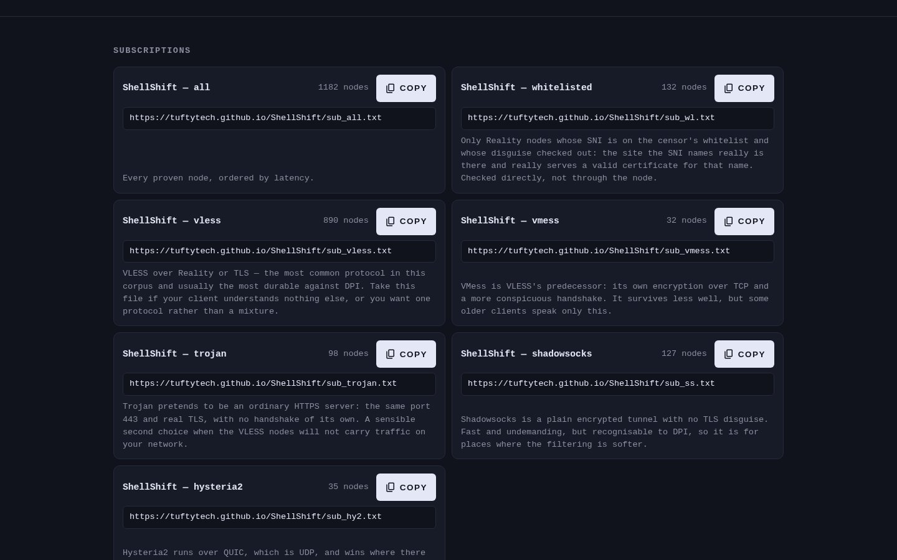
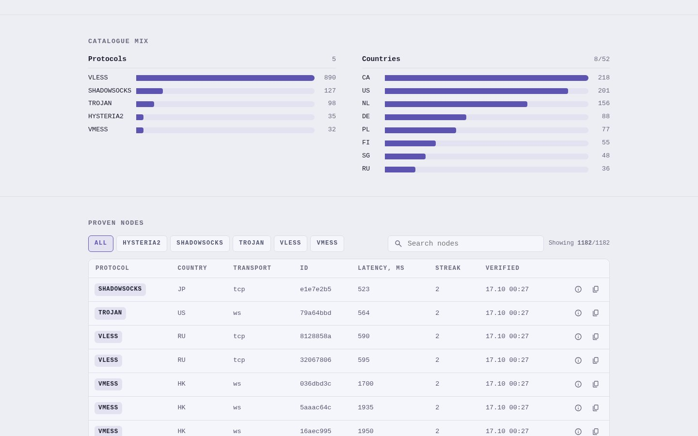
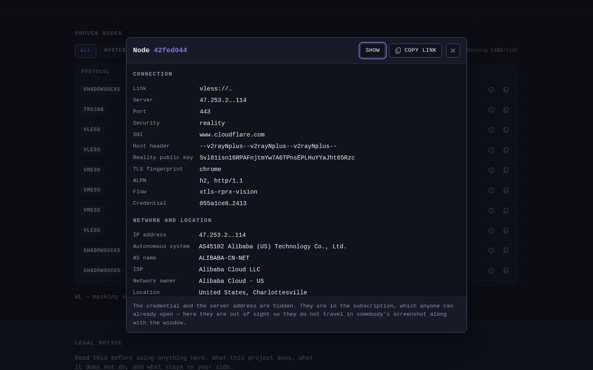
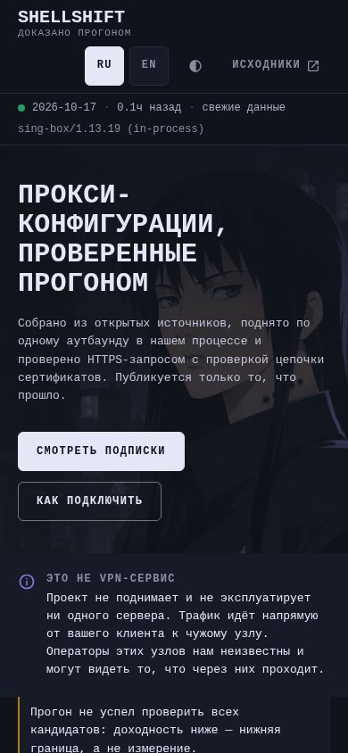

<h1> ShellShift</h1>

A Self-verifying Aggregator of Public Proxy Configurations: VLESS Reality, VMess, Trojan, Shadowsocks & Hysteria2, Built in Go

[](https://tuftytech.github.io/ShellShift)
[](#documentation)
[](README.ru.md)
[](https://github.com/TuftyTech/ShellShift/actions/workflows/ci.yml)
[](https://github.com/TuftyTech/ShellShift/actions/workflows/publish.yml)
[](https://github.com/TuftyTech/ShellShift/releases)
[](https://github.com/TuftyTech/ShellShift/releases/latest)
[](https://go.dev)
[](LICENSE)
[](https://hitsofcode.com/github/TuftyTech/ShellShift/view?branch=main)
[](https://github.com/TuftyTech/ShellShift)

<div>
  <a href="https://github.com/TuftyTech/ShellShift/releases/latest">
    
  </a>
  &nbsp;
  <a href="https://tuftytech.github.io/ShellShift">
    
  </a>
</div>

# Documentation

New to ShellShift or want to know exactly what "proven" means? **[Start with How it works](#how-it-works)**, or read everything **[in Russian](README.ru.md)**.

> [!CAUTION]
> **ShellShift is not a VPN service.** It runs and operates no servers. Traffic goes straight from your client to a node somebody else operates, and those operators are unknown and can see what passes through them. The one thing established about each published node is that HTTPS with a valid certificate chain completed through it, at the time the dashboard shows.

# Sections:

- [Documentation](#documentation)
- [Features](#-features)
  - [Proof & Verification](#proof--verification)
  - [Protocols & Transports](#protocols--transports)
  - [Subscriptions & Output](#subscriptions--output)
  - [Dashboard](#dashboard)
  - [Zero-Trust & Security](#zero-trust--security)
  - [Automation](#automation)
  - [Some additional cool features](#some-additional-cool-features)
- [How it works](#how-it-works)
- [Screenshots](#screenshots)
- [Installation](#installation)
  - [Just want the subscriptions?](#just-want-the-subscriptions)
  - [Running ShellShift yourself](#running-shellshift-yourself)
  - [Building from source](#building-from-source)
  - [Deploying your own instance](#deploying-your-own-instance)
  - [Configuration](#configuration)
- [Client Apps](#client-apps)
- [Network Note](#network-note)
- [Architecture](#architecture)
- [Special Thanks](#special-thanks)
- [Translate](#translate)
- [Contribute](#contribute)
- [Support](#support)
- [Links](#links)
- [LICENSE](#license)

# 🎉 Features

- Everything you might expect from a proxy aggregator, except that nothing gets published on trust:

## Proof & Verification

- Every node is dialled **in-process** through its own sing-box outbound, so a malformed node can only fail itself.
- A node counts as proven only after a full **HTTPS request with a verified certificate chain** goes through that tunnel. A plaintext `204` is not proof, and certificate checks are never switched off.
- Evidence-driven scheduling: a cheap reachability signal first, per-node deadlines from the observed p95 connect time, probes raced under one hard deadline, early abort. No unconditional sleeps.
- Optional throughput measurement on top of latency.
- A `doctor` command that tells "the nodes are dead" apart from "this machine cannot reach the proof endpoints" in two minutes.

## Protocols & Transports

- VLESS (Reality & TLS), VMess, Trojan, Shadowsocks (including 2022-blake3) and Hysteria2.
- tcp, ws, grpc, httpupgrade / xhttp, http / h2 and quic transports.
- uTLS fingerprints, SIP003 plugins, Reality public keys & short IDs.
- Closed sets: anything unrecognised is rejected at the boundary with a countable reason instead of being carried along as a string.

<details>

<summary>Full protocol matrix</summary>

| | Supported |
|---|---|
| **Protocols** | `vless` · `vmess` · `trojan` · `ss` (Shadowsocks) · `hy2` / `hysteria2` |
| **Transports** | `tcp` (`raw`, `none`) · `ws` · `grpc` · `httpupgrade` (`xhttp`) · `http` / `h2` · `quic` |
| **Security** | `none` · `tls` · `reality` |
| **uTLS fingerprints** | chrome, firefox, edge, safari, 360, qq, ios, android, random(ized) |
| **Shadowsocks ciphers** | AES-128/192/256-GCM, (x)chacha20-ietf-poly1305, and the three 2022-blake3 ciphers |
| **SIP003 plugins** | `obfs-local` (`simple-obfs`) · `v2ray-plugin` |

Hysteria **v1** is rejected everywhere, deliberately and consistently. The predecessor accepted it in one code path and ignored it in another, so v1 links were dropped from feeds but admitted from the pool and treated as v2 (`INV-12`).

</details>

## Subscriptions & Output

- Seven plain-text subscription files: everything, whitelisted, and one per protocol.
- `sub_wl.txt` holds Reality nodes whose SNI is on a censor whitelist **and** whose masking target was checked directly: the site exists and serves a valid certificate for its own name.
- `network.json`, the full machine-readable payload: funnel, per-node attestation and everything the dashboard shows.
- No accounts, no tokens, no per-user URLs. Everybody gets the same bytes.
- A bundle nothing qualified for still renders with its header instead of disappearing.

<details>

<summary>Published files</summary>

| File | Contents |
|---|---|
| `sub_all.txt` | every proven node, sorted by latency |
| `sub_wl.txt` | Reality nodes with a whitelisted SNI and proven masking |
| `sub_vless.txt` | VLESS over Reality or TLS, the most common protocol and usually the most durable against DPI |
| `sub_vmess.txt` | VMess |
| `sub_trojan.txt` | Trojan |
| `sub_ss.txt` | Shadowsocks |
| `sub_hy2.txt` | Hysteria2 |
| `network.json` | funnel, per-node attestation, and everything the detail card shows |
| `state/ledger.json` | the run's memory, published so the next run can fetch it back |

</details>

## Dashboard

- Static bilingual site (Russian & English) with light & dark themes.
- Heartbeat bar: when the data was produced and whether it is still fresh.
- The funnel, rendered as an accounting identity: every stage counts what it dropped and the numbers add up.
- Catalogue mix by protocol and country, plus a searchable & filterable node table.
- Node detail card with the link, server, resolved IP and credential **masked until you press Show**. <sub><code>new</code></sub>
- Endpoints live only in the fetched payload, never in the HTML, so a crawler indexes nothing and a screenshot leaks nothing.
- Ships its own Content-Security-Policy.

## Zero-Trust & Security

- Schema-first validation against explicit allowlists, never blocklists.
- Resolve once, vet the resolved address, dial the pinned address. That also closes the DNS rebinding window.
- Egress guard for every protocol & transport: loopback, private ranges, CGNAT, link-local (including the cloud metadata address), multicast, reserved and their IPv6 equivalents are all denied.
- `allowinsecure`, `insecure` and `allow_insecure` are dropped on publication, so a published link never asks a client to skip certificate checks.
- Secrets are redacted in logs, and the node ID is a SHA-256 hash of the canonical form, never the credential itself.

## Automation

- Scheduled publish every two hours at `:17`, straight to GitHub Pages through the Pages artifact. Nothing generated is ever committed to `main`.
- Mirror branch: every run also force-pushes the subscriptions to `subs` as a single orphan commit, so they have a second address on `raw.githubusercontent.com` and the branch never grows a history.
- Ledger round trip: the run's memory (hashes and statistics only) is published with the site and fetched back by the next run. No cache, and never in git.
- Publication guard: a run may replace what is live only if its result is plausible. An empty run never wipes the subscriptions.
- The feed list lives in repository secrets and is masked line by line in the logs.
- Prebuilt release binaries for Linux, macOS & Windows on amd64 & arm64, with SHA-256 checksums. <sub><code>new</code></sub>

## Some additional cool features

- **Yield-weighted feeds:** measured history showed one feed producing 48% of all live nodes from 3% of the parse volume, so feeds are ordered by what they actually yield, not round-robin.
- **A pool that decays:** re-check intervals widen with observed stability, failures back off exponentially, stale entries age out.
- **`decode -rejects`:** pipe any feed in and see every line that was refused, with the reason.
- **`paramdiff`:** re-encode a corpus offline and see which query parameters publication drops, adds or changes.
- **`proofbench`:** the raw proof-error distribution by transport, for tuning budgets and concurrency.
- **56 invariants** (`INV-00` … `INV-55`), each one closing a production failure the predecessor actually paid for, each one named by number in a test.

# How it works

One static Go binary runs one collection cycle end to end:

1. **Fetch** subscription feeds over HTTPS under hard byte, line and time limits.
2. **Decode** every line into a validated node, or reject it with a machine-countable reason.
3. **Vet** each node at the Zero-Trust boundary: allowlisted fields, one DNS resolution, a pinned address.
4. **Prove** it: build a sing-box outbound for that one node, in-process, and make it complete an HTTPS request with a verified certificate chain.
5. **Classify** it: is its Reality masking target real? Checked directly, not taken from a list.
6. **Publish** the survivors, but only if the result is plausible enough to replace what is already live.

The funnel published with each run is an accounting identity, not a summary:

```
Collected == Rejected + Duplicates + Deferred + NotAttempted + Failed + Proven
```

<details>

<summary>Funnel stages explained</summary>

| Stage | Meaning |
|---|---|
| **collected** | lines fetched from every feed |
| **rejected** | lines decoding refused, counted by reason (`unknown_scheme`, `bad_uuid`, `unsupported_cipher`, `bad_psk_length`, `bad_reality_key`, …) |
| **decoded** | lines that produced a valid node |
| **duplicates** | decoded nodes another feed had already named |
| **candidates** | distinct nodes after deduplication |
| **deferred** | candidates the ledger said were not worth a full verification this run |
| **policy** | nodes that passed the Zero-Trust boundary |
| **reached** | nodes that answered a cheap reachability signal |
| **failed** | nodes verification attempted and rejected |
| **not_attempted** | nodes that were due but never reached, because the run budget ran out first |
| **proven** | nodes published |

Counting rejections *by reason* is what makes a parser regression visible instead of looking like feed churn.

</details>

> [!NOTE]
> **What "proven" means, precisely:** an HTTPS `GET` to one of three well-known connectivity endpoints (`www.gstatic.com`, `cp.cloudflare.com`, `connectivitycheck.gstatic.com`), completed through the node's own outbound, **with the certificate chain verified**. Not a plaintext `204`, which a hostile or captive node can forge (`INV-31`), and never with verification disabled (`INV-30`, `INV-38`).

# Screenshots

| Dark | Light |
|:---:|:---:|
|  |  |
|  |  |

| Node detail card | Mobile |
|:---:|:---:|
|  |  |

# Installation

| Platform | Stable |
|---|---|
| **Linux** | [](https://github.com/TuftyTech/ShellShift/releases/latest/download/shellshift_linux_amd64.tar.gz) [](https://github.com/TuftyTech/ShellShift/releases/latest/download/shellshift_linux_arm64.tar.gz) |
| **macOS** | [](https://github.com/TuftyTech/ShellShift/releases/latest/download/shellshift_darwin_arm64.tar.gz) [](https://github.com/TuftyTech/ShellShift/releases/latest/download/shellshift_darwin_amd64.tar.gz) |
| **Windows** | [](https://github.com/TuftyTech/ShellShift/releases/latest/download/shellshift_windows_amd64.zip) [](https://github.com/TuftyTech/ShellShift/releases/latest/download/shellshift_windows_arm64.zip) |

Every archive is one static binary plus the licence, both READMEs and the example configuration. Checksums are in [`SHA256SUMS.txt`](https://github.com/TuftyTech/ShellShift/releases/latest/download/SHA256SUMS.txt).

### Just want the subscriptions?

You don't need to install anything. Open the **[live dashboard](https://tuftytech.github.io/ShellShift)**, copy a subscription URL and paste it into your client:

```
https://tuftytech.github.io/ShellShift/sub_all.txt
```

Swap `sub_all.txt` for `sub_wl.txt`, `sub_vless.txt`, `sub_vmess.txt`, `sub_trojan.txt`, `sub_ss.txt` or `sub_hy2.txt` to get a narrower list.

If `github.io` is blocked on your network, every run mirrors the same files to the `subs` branch:

```
https://raw.githubusercontent.com/TuftyTech/ShellShift/subs/sub_all.txt
```

### Running ShellShift yourself

1. **Download & check**

   Grab the archive for your platform from the table above, unpack it and compare it against `SHA256SUMS.txt`.

2. **Get the positive controls first**

   ```bash
   ./shellshift doctor
   ```

   `doctor` requests each proof endpoint directly with no tunnel, then runs the prover itself over a path known to work. If either fails, the problem is your network, not the nodes.

3. **Give it a feed list**

   Copy `config/sources.example.json` to `config/sources.json` and add a `sources` array, or pass the list through `SHELLSHIFT_SOURCES` (one URL per line). See [Configuration](#configuration).

4. **Run a cycle**

   ```bash
   # verify and report without writing anything
   ./shellshift run -config config/sources.json -dry-run

   # one full cycle: fetch, verify, classify, publish into dist/
   ./shellshift run -config config/sources.json -out dist -state .state/ledger.json
   ```

<details>

<summary>All commands</summary>

| Command | What it does |
|---|---|
| `run` | one full cycle: collect, verify, classify, publish |
| `site` | render the static site from a published `network.json` (no network, no verification) |
| `decode` | decode proxy URIs from stdin and report what was rejected (`-rejects`, `-json`, `-labels`) |
| `doctor` | establish the positive controls a diagnosis needs (`INV-55`) |
| `version` | print the build version |

```bash
./shellshift site -data dist/network.json -out dist -origin https://tuftytech.github.io/ShellShift
./shellshift decode -rejects < some-feed.txt
```

</details>

### Building from source

> [!IMPORTANT]
> **The `with_utls` build tag is not optional.** sing-box keeps uTLS, and the Reality client with it, behind that tag. Without it every Reality node fails to construct and is silently dropped (in one real corpus that was 540 of 865 nodes), which looks like the feeds degraded rather than a build mistake. `tunnel.CheckBuild()` refuses to start a run in that state (`INV-49`).

```bash
git clone https://github.com/TuftyTech/ShellShift.git
cd ShellShift
./tools/install-hooks.sh                         # once: installs the pre-commit hygiene hook

go build -tags with_utls -o shellshift ./cmd/shellshift
./tools/verify.sh                                # every gate CI runs
```

Requires Go 1.26 or newer. No cgo, no companion processes.

### Deploying your own instance

1. **Fork** the repository.
2. Add the repository secrets in **Settings → Secrets and variables → Actions**:

   | Secret | Purpose |
   |---|---|
   | `SHELLSHIFT_SOURCES` | the feed list, one URL per line (**required**) |
   | `SHELLSHIFT_WHITELIST_DOMAINS` | domain lists for whitelist classification (optional) |
   | `SHELLSHIFT_WHITELIST_NETWORKS` | CIDR lists for the same (optional) |

3. In **Settings → Pages**, set **Source** to **GitHub Actions**.
4. Change `site_url` in `config/run.json` and `SITE_ORIGIN` in `.github/workflows/publish.yml` to your own Pages address.
5. Start **Actions → publish → Run workflow**, or wait for the next `:17` slot.

> [!NOTE]
> The scheduled run refuses to start without `SHELLSHIFT_SOURCES` and says so by name. A missing whitelist list is only a warning, but it is announced, so "nobody qualified" never looks like "nobody could qualify".

### Configuration

One JSON file, loaded explicitly. `config/sources.example.json` shows the shape and deliberately carries **no** `sources` key: a line that looks like a feed URL in a public tree is a line somebody copies.

<details>

<summary>Fields & environment overrides</summary>

| Field | Meaning |
|---|---|
| `sources` | feed URLs to collect from |
| `whitelist_domains` | URLs of domain lists used for whitelist classification |
| `whitelist_networks` | URLs of CIDR lists used for the same |
| `site_url` | published origin, used for subscription links |
| `run_budget` | wall-clock ceiling on the verification phase (e.g. `"6m"`) |
| `concurrency` | verification fan-out |
| `proof_concurrency` | fan-out for the proof requests specifically |
| `geoip` | resolve node country |
| `measure_throughput` | measure throughput as well as latency |

Three variables replace the matching lists **after** the file is read and **before** it is validated:

| Variable | Replaces |
|---|---|
| `SHELLSHIFT_SOURCES` | `sources` |
| `SHELLSHIFT_WHITELIST_DOMAINS` | `whitelist_domains` |
| `SHELLSHIFT_WHITELIST_NETWORKS` | `whitelist_networks` |

One URL per line, blank lines and `#` comments ignored. Two properties are deliberate and both have tests:

- A variable **replaces** its list instead of merging into it. A merge would silently keep feeds the operator had removed.
- A variable that is **set but lists nothing is an error**, not a fall back to the file. That case is a misconfigured secret.

</details>

### Client Apps:

> [!TIP]
> **Any client that understands subscription URLs works, for example:**
>
> - 📦 [sing-box](https://github.com/SagerNet/sing-box), the same core ShellShift proves nodes with
> - 🌀 [Hiddify](https://github.com/hiddify/hiddify-app) on Android, iOS, Windows, macOS & Linux
> - 🤖 [v2rayNG](https://github.com/2dust/v2rayNG) on Android
> - 🍏 Streisand and YukariBox on iOS

### Network Note:

#### What ShellShift connects to and why:

> - **Feed URLs** from your configuration: over HTTPS, with hard byte, line and time limits.
> - **Your system DNS resolver**: once per node. The resolved address is vetted, then pinned for the dial.
> - **The node itself**: through its own in-process sing-box outbound, never to a private or reserved address.
> - **`www.gstatic.com`, `cp.cloudflare.com`, `connectivitycheck.gstatic.com`**: the proof request, sent *through* the node.
> - **Reality masking targets**: a direct TLS handshake on port 443 to check the site exists and serves a valid certificate for its own name.
> - **`ip-api.com`**: a batch country lookup for proven nodes. Set `geoip` to `false` to switch it off.
> - **Your published site**: the scheduled workflow fetches the previous `state/ledger.json` back from it.
>
> Nothing about visitors of the dashboard is collected or stored: it is static files.

# Architecture

One static Go binary. No companion interpreter, no sidecar process, nothing read at import time. Every subcommand is a pure function of its flags and the files it is pointed at.

<details>

<summary>Packages & load-bearing decisions</summary>

```
cmd/shellshift        run · site · decode · doctor · version
internal/model        canonical types; structural node identity
internal/decode       URI -> validated node; INV-01..29 live here
internal/intake       feed fetching with hard limits, yield-weighted ordering
internal/policy       Zero-Trust boundary: egress guard, resolver, whitelist, masking, geoip
internal/tunnel       the only dialing interface; sing-box as a library, one outbound per node
internal/verify       verdict: HTTPS with a verified chain; adaptive budgets; throughput
internal/ledger       memory: pool with decay, source yield
internal/publish      bundles, network.json, the static site (html/template + embedded assets)
internal/pipeline     one collection cycle; the concurrency scheduler
internal/obs          structured logs with secret redaction
internal/config       explicit configuration loading
```

- **sing-box is a library, not a subprocess.** The predecessor ran one sing-box process per batch of fifty sharing one configuration, so a single rejected outbound killed all fifty (`INV-00`).
- **The dialer is handed a resolved address, never a hostname.** Given a name, an in-process outbound would need sing-box DNS, routing and service registries reachable from hostile input (`INV-33`, `INV-48`).
- **Identity is structural and hashed**, because the tuple contains a credential and the key is written to logs, state and the dashboard (`INV-21`).
- **Assembling a result and publishing it are separate.** `pipeline.Runner` never writes; `publish.Guard` decides. The predecessor emptied every subscription file on a run with no survivors (`INV-43`).
- **Artifacts are never committed to `main`.** The predecessor committed ~406 KB of regenerated files per run, six times a day. The `subs` mirror is one orphan commit replaced on every run, so it holds a single copy and no history.

</details>

<details>

<summary>Testing & gates</summary>

`./tools/verify.sh` runs gofmt, `go build`, `go vet`, the test suite with the race detector, a no-skipped-tests check, `govulncheck`, the hygiene gates and a CLI smoke test. It refuses to report a gate that did not run as a gate that passed.

- **A skipped test fails CI.**
- **An invariant counts as ported only when a test names its number.** `tools/hygiene.sh` fails when a declared `INV-nn` is named in no `_test.go`.
- **Every action a workflow uses is pinned to a 40-character commit SHA**, never a movable tag.
- **No generated artifact, binary or credential-shaped string may enter the index.**
- **Two fidelity gates guard publication:** sing-box options built from the original URI against ours, and a check that fails when publication starts losing a query parameter for no stated reason.

The invariant catalogue itself is kept outside the public tree because it contained operational URLs. On a clean checkout that gate reports **НЕ ПРОВЕРЕНО** (*not run*) instead of passing, and says so in its last line.

</details>

### Special Thanks:

> - [@SagerNet](https://github.com/SagerNet) & nekohasekai for [sing-box](https://github.com/SagerNet/sing-box) and [sing](https://github.com/SagerNet/sing), which every proof runs through.
> - [MetaCubeX](https://github.com/MetaCubeX) for the uTLS fork that makes Reality possible.
> - The [quic-go](https://github.com/quic-go/quic-go) and [miekg/dns](https://github.com/miekg/dns) maintainers.
> - [ip-api.com](https://ip-api.com) for the free batch geolocation endpoint.
> - Everyone keeping public feeds alive.

# Translate

- The dashboard speaks Russian and English. All interface strings live in [`internal/publish/strings.go`](internal/publish/strings.go), and `TestStringsNamedFromGoExistInBothLanguages` fails when a key exists in one language but not the other.
- Want another language? Add a table next to `ru` and `en` and open a pull request.

# Contribute

- Read `internal/decode`, `internal/verify` and `internal/tunnel` before changing them: the guards in there are not stylistic.
- Run `./tools/verify.sh` before pushing. It is the same set of gates CI runs.
- Name the invariant a test enforces (`INV-nn`) or the rule it encodes (`GHOST-nnn`).
- Comments explain **why**, and cite the failure a guard exists for.
- Errors carry a machine-countable reason, not just a message.
- An absent value is absent, never a placeholder.
- A gate that cannot fail is worse than no gate.
- Bugs, ideas & questions go through the [issue forms](https://github.com/TuftyTech/ShellShift/issues/new/choose). Security problems go [privately](https://github.com/TuftyTech/ShellShift/security/advisories/new).

<details>

<summary>Commit identity</summary>

Commits are authored as `tuftyxxeW <343729923+tuftyxxeW@users.noreply.github.com>` and carry **no `Co-Authored-By` trailer**, not for any tool, in any form. GitHub builds the Contributors list from the author address *and* from co-author trailers, so both halves matter. A fresh clone needs this set before the first commit:

```bash
git config user.name  "tuftyxxeW"
git config user.email "343729923+tuftyxxeW@users.noreply.github.com"
```

</details>

# Support

- The best support is a working node report and a clear bug report.
- Don't forget to 🌟 star the repo if ShellShift is useful to you ^^

# Links

- 📡 [Live dashboard](https://tuftytech.github.io/ShellShift)
- 🐛 [Issues](https://github.com/TuftyTech/ShellShift/issues)
- 🛰️ [Node report](https://github.com/TuftyTech/ShellShift/issues/new?template=node-report.yml) for node operators and rights holders. Well-founded requests are acted on, usually by the next scheduled run.
- 🔒 [Security advisories](https://github.com/TuftyTech/ShellShift/security/advisories/new)

> [!WARNING]
> ShellShift lives only at **github.com/TuftyTech/ShellShift** and **tuftytech.github.io/ShellShift**.
> Any other site offering "ShellShift" subscriptions or binaries is not us, and we are not responsible for what you download there.

# LICENSE

Project is licensed under the **[GNU General Public License v3.0 or later](LICENSE)**.

```
© Copyright (C) 2026-present TuftyTech
- ShellShift links sing-box and sing (GPL-3.0-or-later) statically into one binary,
  so the combined work is distributed under GPL-3.0-or-later as well.
- sing-box and sing are © 2022 nekohasekai, with an additional term under GPL section 7:
  no derivative work may use their name or imply association without prior consent.
```

ShellShift is not affiliated with, endorsed by or associated with the sing-box project or its authors. Protocol names (VLESS, VMess, Trojan, Shadowsocks, Hysteria2, Reality) and client names are used descriptively; all trademarks belong to their respective owners.

---
